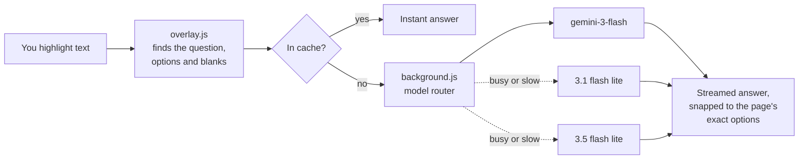

<div align="center">


# Canvax

**Highlight anything. Get the answer. Instantly.**

A tiny terminal-style AI overlay for your browser, powered by Google Gemini.
Select text on any page and the answer streams in before you've lifted your finger off the mouse.

[](https://github.com/zynthoz/canvaxV2/releases/latest)
[](https://github.com/zynthoz/canvaxV2/releases)


<br />

[](https://github.com/zynthoz/canvaxV2/releases/latest/download/canvax-chrome.zip)
&nbsp;
[](https://github.com/zynthoz/canvaxV2/releases/latest/download/canvax-firefox.zip)

</div>

---

## ✨ Features

|  |  |
|---|---|
| ⚡ **Zero-click answers** | Just highlight text. No buttons, no copy-paste, no tab switching. |
| 🌊 **Streaming** | Answers appear word-by-word as Gemini generates them. |
| 🧠 **Understands forms** | Reads dropdowns, radio buttons, checkboxes and blanks around your selection and answers in the right format. |
| 🎯 **Verbatim options** | Multiple-choice answers are snapped to the page's *exact* option text, so what you copy is what you pick. |
| 📄 **Screen mode** | Scans the whole page and answers every question it finds in one go. |
| 🛟 **Never stuck** | Automatically fails over between Gemini models when one is busy, rate-limited or slow. |
| 💾 **Smart cache** | Repeat questions are answered instantly, even across pages and sessions. |
| ❓ **Honest** | Low-confidence answers get a `?` badge so you know to double-check. |
| 🖼️ **Works in iframes** | Embedded quizzes and LMS frames are supported. |
| 🌗 **Themes** | Auto (matches the page), light or dark. Drag it anywhere, resize it however you like. |
| 🔒 **Private** | No servers, no accounts, no tracking. Your key and cache never leave your browser. |

---

## 📦 Install

> **Takes about 60 seconds.** You need a free Gemini API key. [Get one here](https://aistudio.google.com/app/apikey) (sign in with Google → **Create API key** → copy it).

### Chrome · Edge · Brave · Opera · Arc · Vivaldi

1. **[⬇ Download `canvax-chrome.zip`](https://github.com/zynthoz/canvaxV2/releases/latest/download/canvax-chrome.zip)** and unzip it.
   Put the folder somewhere permanent (e.g. `Documents/canvax`). The browser loads it from there, so don't delete it.
2. Open the extensions page by pasting this into your address bar:

   | Chrome / Brave / Arc / Vivaldi | Edge | Opera |
   |---|---|---|
   | `chrome://extensions` | `edge://extensions` | `opera://extensions` |

3. Switch on **Developer mode** (top-right toggle; in Edge it's in the left sidebar).
4. Click **Load unpacked** and select the unzipped folder (the one containing `manifest.json`).
5. Done! 📌 Pin Canvax from the 🧩 puzzle-piece menu so it's one click away.

<details>
<summary><b>Tip:</b> skip the folder picker</summary>
<br />

With `chrome://extensions` open and Developer mode on, you can simply **drag the unzipped folder onto the page**.
</details>

### Firefox

1. **[⬇ Download `canvax-firefox.zip`](https://github.com/zynthoz/canvaxV2/releases/latest/download/canvax-firefox.zip)**. No need to unzip.
2. Paste `about:debugging#/runtime/this-firefox` into the address bar.
3. Click **Load Temporary Add-on…** and pick the zip.

> [!NOTE]
> Firefox removes temporary add-ons when it restarts. If the release includes a signed **`canvax-firefox.xpi`**, click it instead for a permanent one-click install.

### First run

1. Press <kbd>Alt</kbd> + <kbd>Q</kbd> (or click the Canvax toolbar icon) on any webpage.
2. Paste your Gemini API key and click **connect**.

That's it. You only have to do this once.

---

## 🚀 Usage

### Highlight mode (default)

Select any text: a question, a word, a whole quiz item. Pause for a moment and the answer streams into the overlay.

```text
┌ canvax ─────────────────────── ⚙ × ┐
│ Q  What is the powerhouse of the… │
│                                   │
│ Mitochondria               [copy] │
│                                   │
│                     [copy] [clear]│
└───────────────────────────────────┘
```

Canvax looks at the question your selection belongs to, so highlighting just the question text is enough. It finds the options, dropdowns or blanks around it automatically.

| Question type | What you get |
|---|---|
| Multiple choice | The exact text of the correct option |
| Select all that apply | Every correct option, one per line |
| True / False | `True` or `False` |
| Dropdown / matching | `#dropdown → #option. text` for each one |
| Fill in the blank / identification | Just the answer, ready to type |
| Anything else | A 1–2 sentence explanation |

### Screen mode

Open **⚙ settings** → pick **screen** → click **done**. Canvax reads the entire page and answers every question it finds, numbered in order. Click **⚙ → done** again to rescan after the page changes.

### Controls

| Action | How |
|---|---|
| Show / hide (all tabs) | <kbd>Alt</kbd> + <kbd>Q</kbd>, the toolbar icon, or **×** |
| Copy one answer | **copy** next to that line |
| Copy everything | **copy** in the footer |
| Re-ask without the cache | Click the **cached ↻** tag |
| See the full question | Click the **Q** preview to expand it |
| Move / resize | Drag the title bar / drag the bottom-right corner |
| Settings | **⚙**: mode, theme, change API key |

### Reading the tags

| Tag | Meaning |
|---|---|
| `cached ↻` | Answered instantly from cache. Click to ask Gemini again. |
| `answered by 3.1 flash lite` | The main model was busy, so a backup answered. |
| `?` badge | Gemini isn't sure. Double-check this one. |

### Change the shortcut

- **Chrome / Edge / Brave:** `chrome://extensions/shortcuts`
- **Firefox:** `about:addons` → ⚙ → **Manage Extension Shortcuts**

---

## 🔄 Updating

1. Download the latest zip from the button at the top.
2. Unzip it **over your existing Canvax folder** (replace all files).
3. On `chrome://extensions`, click the **↻ reload** icon on the Canvax card, then refresh any open tabs.

Your API key, theme and cache are kept.

---

## 🩺 Troubleshooting

| Problem | Fix |
|---|---|
| Overlay doesn't appear | Refresh the tab. Extensions can't run on `chrome://` pages, the Web Store, or PDF viewers. |
| `bad key` | Your key is wrong or revoked. Create a new one at [AI Studio](https://aistudio.google.com/app/apikey) and use **⚙ → change key**. |
| `rate limited` | You've hit the free-tier limit. Wait a minute; Canvax already rotates between models for you. |
| `extension was updated — refresh this page` | You reloaded the extension. Refresh the tab. |
| "Disable developer mode extensions" popup (Chrome) | Safe to dismiss. Chrome shows it for every extension that isn't from the Web Store. |
| Nothing happens when highlighting | Check that **⚙ → mode** is set to **highlight**, and that you selected at least 3 characters. |
| Firefox add-on disappeared | Temporary add-ons are removed on restart. Load it again, or use the signed `.xpi`. |

---

## 🔒 Privacy

- Your API key is stored **locally** in your browser's extension storage.
- Highlighted text is sent **directly** from your browser to Google's Gemini API, and nowhere else.
- No analytics, no telemetry, no third-party servers.
- The answer cache (last 150 answers) lives in local extension storage. Removing the extension deletes it.

Canvax needs access to all sites so it can read your selection on whatever page you're on.

---

## ⚙️ How it works



The router remembers which models recently failed and skips them. It starts a backup in parallel if the leader hasn't replied within 4 seconds, and the first one to answer wins.

---

## 🛠️ Development

```text
canvaxV2/
├── extension/                  ← load this folder unpacked while developing
│   ├── manifest.json           Chrome / Chromium manifest
│   ├── manifest.firefox.json   Firefox manifest (background scripts instead of service worker)
│   ├── background.js           Gemini streaming + model routing
│   ├── overlay.js              UI, selection watcher, form parsing, cache
│   ├── overlay.css             Overlay styles (isolated in a shadow DOM)
│   └── icons/
├── scripts/build.sh            Builds dist/canvax-chrome.zip and dist/canvax-firefox.zip
└── .github/workflows/release.yml
```

**Run locally:** load `extension/` with **Load unpacked**. After editing, click ↻ on `chrome://extensions` and refresh the tab.

**Build:**

```bash
./scripts/build.sh     # requires zip + jq
```

The build refuses to run if `HARDCODED_KEY` in `background.js` isn't empty, so a test key can't ship by accident.

**Release:** bump `"version"` in **both** manifests and push to `main`. GitHub Actions builds the packages and publishes release `v<version>`, and the download buttons above update automatically. Pushes that don't change the version refresh the current release's files.

<details>
<summary><b>Optional:</b> one-click permanent Firefox install</summary>
<br />

1. Create API credentials at [addons.mozilla.org/developers/addon/api/key](https://addons.mozilla.org/developers/addon/api/key/).
2. Add them as repository secrets named `AMO_JWT_ISSUER` and `AMO_JWT_SECRET`.
3. Each new version is then signed by Mozilla (unlisted, so it stays private) and attached as `canvax-firefox.xpi`.
</details>

---

<div align="center">
<sub>Built with ☕ and the Gemini API · <a href="https://github.com/zynthoz/canvaxV2/issues">Report a bug</a></sub>
</div>
